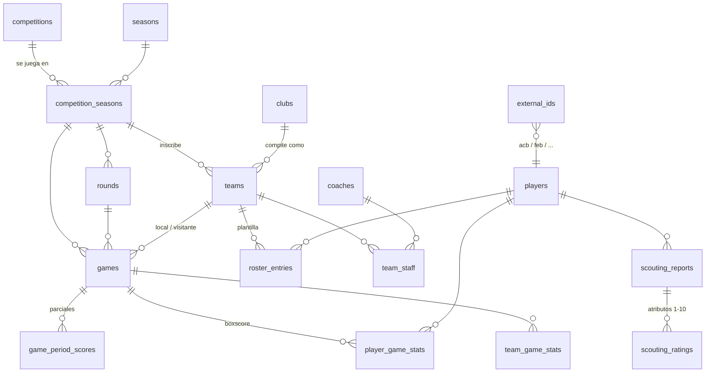

# Arquitectura de D3 Basket

## Visión general

```
┌──────────────────────────── Electron ────────────────────────────┐
│  Renderer (React)  ──IPC (preload, contextIsolation)──►  Main     │
│  vistas: inicio, calendario, equipos, jugador, boxscore, scouting │
│                                                  │                │
│                                   Queries (lectura) / Writer      │
│                                                  │                │
│                              SQLite (better-sqlite3, WAL)         │
│                                                  ▲                │
│                     Scraper (adaptadores por liga) ── HttpClient  │
└──────────────────────────────────────────────────┬───────────────┘
                 CLI (tsx) usa el mismo scraper ───┘
```

- **Una sola base de datos** compartida por la app y la CLI (`%APPDATA%\D3Basket\d3basket.db`, configurable con `D3_DB_PATH`).
- **better-sqlite3 v13** trae binarios N-API precompilados: el mismo módulo funciona en Node (CLI, tests) y en Electron **sin recompilar**.
- El scraper se ejecuta tanto desde la CLI como desde la propia app (botón *Sincronizar*), con progreso en vivo por IPC.

## Modelo de datos

Principios:

1. **IDs internos propios + tabla `external_ids`.** Cada entidad (club, equipo, jugador, partido...) tiene un id interno; los ids de cada fuente (`acb`, `feb`, `proballers`...) se guardan aparte. Así un mismo jugador puede enlazarse entre ACB y LEB, y volver a ejecutar el scraper **actualiza en lugar de duplicar** (idempotente).
2. **Club ≠ equipo.** `clubs` es la entidad estable (Real Madrid, club 9 en la ACB); `teams` es ese club en una edición concreta, con su nombre de patrocinio, colores y logo de ese año. El histórico de clubes de un jugador sale de `roster_entries` a lo largo de las temporadas.
3. **Edición = competición × temporada** (`competition_seasons`). Es la unidad de sincronización y lo que permite guardar varias temporadas y ligas a la vez.
4. **Estadísticas por periodo.** `player_game_stats` y `team_game_stats` guardan el partido completo (`period = 0`) y cada cuarto/prórroga (`1..n`), útil para scouting (rendimiento en último cuarto, etc.).
5. **Nunca se pisa un dato conocido con un vacío** (`COALESCE` en los upserts).



| Tabla | Contenido |
|---|---|
| `competitions` | ACB, LEB Oro (Primera FEB), LEB Plata (Segunda FEB). Sembradas en la migración. |
| `seasons` | 2026-27, 2025-26... |
| `competition_seasons` | Edición (p.ej. Liga Endesa 2026-27 = `editionId 91` en acb.com). Marca `is_current`. |
| `clubs` / `teams` | Entidad estable / participación en una edición. |
| `players` | Datos biográficos: nombre, apodo, nacimiento (fecha, lugar, país), nacionalidad, altura, posición, foto. |
| `coaches`, `team_staff` | Entrenador principal y ayudantes por equipo-temporada. |
| `roster_entries` | Jugador en equipo-temporada: dorsal, posición, licencia (JFL/EUR/EXT/COT), activo/baja con fechas. |
| `rounds` | Jornadas y fases (`regular`, `playoff`). |
| `games` | Fecha UTC, estado (`scheduled`, `unscheduled`, `live`, `finished`...), marcador, pabellón, público, árbitros. |
| `game_period_scores` | Parciales por cuarto. |
| `player_game_stats` | Boxscore individual: minutos, T2/T3/TL, rebotes of/def, asistencias, robos, pérdidas, tapones (hechos/recibidos), mates, faltas (hechas/recibidas), +/−, valoración. |
| `team_game_stats` | Totales de equipo + acciones de equipo (rebotes/pérdidas de equipo) y entrenador. |
| `scouting_reports`, `scouting_ratings` | Informe de ojeador: rol, arquetipo, fortalezas, debilidades, ataque, defensa, físico, intangibles, comparables, proyección, nivel/potencial (1-10), recomendación, notas por atributo. |
| `scrape_runs` | Registro de cada sincronización: alcance, peticiones, resumen y errores. |
| `v_player_season_stats` | Vista: medias por jugador y equipo-temporada, %T2/%T3/%TL, **TS%** y **eFG%**. |
| `v_standings` | Vista: clasificación de liga regular calculada desde los resultados. |

El esquema completo está en [`src/db/migrations.ts`](../src/db/migrations.ts). Para cambiarlo, añade una migración nueva (no edites una ya publicada).

## Scraper de la ACB

### Cómo lee acb.com

La web actual de la ACB (Next.js App Router) no pinta los datos en tablas HTML estables: los envía serializados en el *payload* de React Server Components (`self.__next_f.push(...)`). `src/scraper/core/rsc.ts` reconstruye ese payload (filas, referencias `$id:ruta`, auto-referencias, filas de texto) y los parsers buscan **objetos por su forma** (claves presentes) en vez de por clases CSS o posiciones. Si la ACB reordena componentes, los datos se siguen encontrando; si cambia los nombres de las claves, el parser lanza un `ParseError` explícito en vez de guardar basura.

| Dato | URL pública | Notas |
|---|---|---|
| Calendario y resultados (temporada actual) | `acb.com/es/liga/calendario` | Los 306 partidos de liga regular en una sola petición, con equipos y marcadores. |
| Plantilla + cuerpo técnico | `acb.com/es/liga/equipos/{slug}/plantilla?editionId=N` | Respeta `editionId` (sirve para temporadas pasadas). Incluye bajas. El slug debe ser el canónico. |
| Ficha de jugador | `acb.com/es/liga/jugadores/{slug}-{id}` | Fecha/lugar de nacimiento, nacionalidad, altura. |
| Boxscore | `live.acb.com/es/partidos/{id}/estadisticas` | Cabecera, parciales, pabellón, público, árbitros y estadísticas por jugador y cuarto. |
| Partidos de un equipo (histórico) | `acb.com/es/liga/equipos/{slug}/partidos?editionId=N` | Única vista pública del calendario que respeta `editionId`. |

> La web consume internamente una API (`api2.acb.com`). **No la usamos**: no está documentada para terceros y puede cambiar de condiciones. Todo sale de páginas públicas.

### Flujo

- **Temporada actual** (`syncCurrent`): calendario → equipos/jornadas/partidos → plantillas (18 peticiones) → fichas de jugador pendientes → boxscores de partidos finalizados que aún no estén guardados.
- **Histórico** (`syncHistoric(año)`, experimental): localiza el `editionId` de esa temporada, recorre los partidos de cada club conocido, descarga los boxscores (que revelan los equipos de esa edición, incluidos clubes ya descendidos) y después sus plantillas.
- **Incremental**: los boxscores ya guardados y las fichas leídas hace menos de 30 días se saltan (`--force` / `--player-max-age` para cambiarlo).

### Convivencia con la web oficial

- Peticiones **secuenciales**, 1 por segundo por host (`--delay`), `User-Agent` identificable.
- Reintentos con *backoff* exponencial ante 429/5xx y errores de red; respeta `Retry-After`.
- `robots.txt` de acb.com y live.acb.com permite el acceso (`Allow: /`) a fecha de hoy.
- `--cache` guarda el HTML crudo en `data/cache/` para depurar cambios de estructura sin volver a pedirlo.

Coste aproximado: sincronización completa de la temporada actual ≈ 270 peticiones (≈ 4,5 min la primera vez); las siguientes solo piden calendario, plantillas y boxscores nuevos (≈ 30 peticiones por jornada).

## Siguientes ligas: LEB Oro y LEB Plata

`baloncestoenvivo.feb.es` es ASP.NET WebForms (HTML clásico con `__VIEWSTATE`):
`calendario.aspx?g=1&t=2026` (Primera FEB / LEB Oro) y `g=2` (Segunda FEB / LEB Plata). El adaptador FEB tendrá que:

1. Parsear tablas HTML (p.ej. con cheerio) y, para cambiar de jornada, reproducir los *postbacks* de WebForms.
2. Devolver los mismos tipos normalizados de [`src/scraper/types.ts`](../src/scraper/types.ts) (`NCalendar`, `NRoster`, `NBoxscore`...). El `Writer` y la interfaz no necesitan cambios.
3. Guardar sus ids en `external_ids` con `source = 'feb'`. El cruce de jugadores ACB↔FEB (nombre + fecha de nacimiento) se hará en una fase posterior.

Fuentes de referencia para enriquecer datos más adelante: Proballers (trayectoria internacional), Basketball-Reference (NBA/NCAA), Hispaligas, Zona de Básquet y BaloncestoTV (contexto y noticias).
